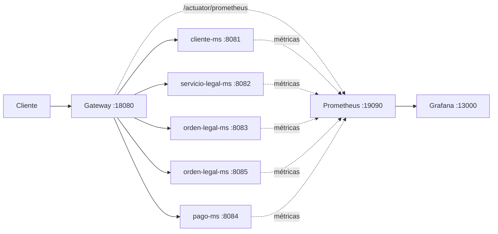

# Observabilidad con Prometheus y Grafana

La observabilidad se incorpora como **anexo de S4** para visualizar el estado y el comportamiento de la arquitectura distribuida sin alterar los requisitos funcionales de la Unidad I.

## Arquitectura



Prometheus obtiene métricas de Spring Boot Actuator. Grafana usa Prometheus como fuente de datos y carga automáticamente el dashboard **Illari Legal — Unidad I**.

## Ejecución

Con PostgreSQL, Config Server, Eureka, microservicios y Gateway ya levantados, ejecutar desde la raíz:

```powershell
docker compose -f .\obs\compose.yml up -d prometheus
```

Verificar `http://localhost:19090/targets`. Las seis entradas monitoreadas deben estar `UP`:

- `legal-gateway`
- `cliente-ms`
- `servicio-legal-ms`
- `orden-legal-ms-8083`
- `orden-legal-ms-8085`
- `pago-ms`

Luego iniciar Grafana:

```powershell
docker compose -f .\obs\compose.yml up -d grafana
```

Abrir `http://localhost:13000`. En DEV el acceso es local y de solo lectura, sin formulario de autenticación. El dashboard está provisionado desde el repositorio, por lo que no requiere configuración manual.

## Evidencia sugerida

Una captura del dashboard con ambas instancias de órdenes en estado `UP` complementa la demostración de S4. Después de ejecutar varias peticiones por el Gateway, el gráfico de peticiones permite observar actividad en las instancias.

## Detención

```powershell
docker compose -f .\obs\compose.yml down
```

Este comando detiene únicamente Prometheus y Grafana.
