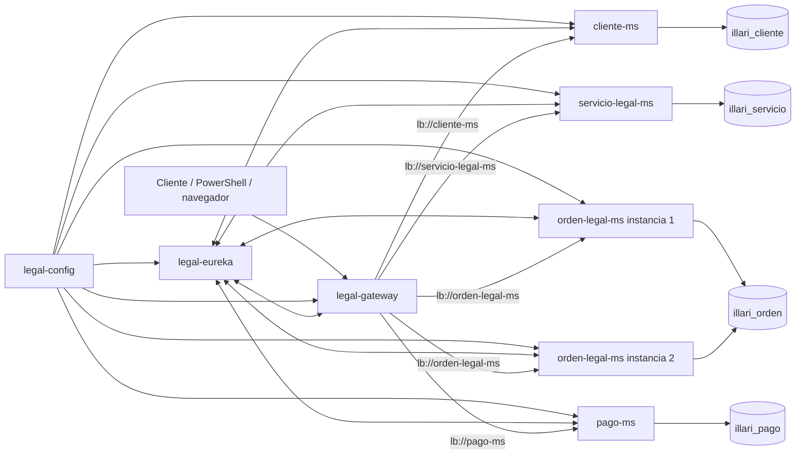

# Producto de la Unidad I — Illari Legal

## 1. Alcance de servicios

El producto mínimo de Illari Legal se divide en cuatro microservicios de negocio y tres componentes de infraestructura.

| Servicio | Responsabilidad | Recurso principal |
|---|---|---|
| `cliente-ms` | Gestionar personas/clientes del estudio | Cliente |
| `servicio-legal-ms` | Mantener el catálogo de servicios jurídicos | Servicio legal |
| `orden-legal-ms` | Registrar solicitudes/órdenes de atención | Orden legal |
| `pago-ms` | Registrar pagos vinculados a una orden | Pago |
| `legal-config` | Entregar configuración por ambiente | Configuración |
| `legal-eureka` | Registrar y descubrir instancias | Registro |
| `legal-gateway` | Enrutar y balancear las solicitudes | Rutas |

Cada microservicio de negocio posee su propia base lógica en PostgreSQL:

- `illari_cliente`
- `illari_servicio`
- `illari_orden`
- `illari_pago`

No existen claves foráneas entre bases de distintos microservicios; los identificadores externos son referencias lógicas, manteniendo el límite de propiedad de los datos.

## 2. Contrato REST

El acceso externo se realiza mediante `legal-gateway`.

| Método | Ruta | Servicio | Resultado esperado |
|---|---|---|---|
| GET | `/api/v1/clientes` | cliente-ms | Lista clientes |
| GET | `/api/v1/clientes/{id}` | cliente-ms | Obtiene cliente |
| POST | `/api/v1/clientes` | cliente-ms | Crea cliente |
| PUT | `/api/v1/clientes/{id}` | cliente-ms | Actualiza cliente |
| DELETE | `/api/v1/clientes/{id}` | cliente-ms | Elimina cliente |
| GET | `/api/v1/servicios` | servicio-legal-ms | Lista servicios |
| POST | `/api/v1/servicios` | servicio-legal-ms | Crea servicio |
| PUT | `/api/v1/servicios/{id}` | servicio-legal-ms | Actualiza servicio |
| DELETE | `/api/v1/servicios/{id}` | servicio-legal-ms | Elimina servicio |
| GET | `/api/v1/ordenes` | orden-legal-ms | Lista órdenes |
| POST | `/api/v1/ordenes` | orden-legal-ms | Crea orden |
| PUT | `/api/v1/ordenes/{id}` | orden-legal-ms | Actualiza orden |
| PATCH | `/api/v1/ordenes/{id}/estado` | orden-legal-ms | Cambia estado |
| DELETE | `/api/v1/ordenes/{id}` | orden-legal-ms | Elimina orden |
| GET | `/api/v1/pagos` | pago-ms | Lista pagos |
| POST | `/api/v1/pagos` | pago-ms | Crea pago |
| PUT | `/api/v1/pagos/{id}` | pago-ms | Actualiza pago |
| PATCH | `/api/v1/pagos/{id}/estado` | pago-ms | Cambia estado |
| DELETE | `/api/v1/pagos/{id}` | pago-ms | Elimina pago |

### Códigos HTTP utilizados

- `201 Created`: creación correcta.
- `200 OK`: consulta o actualización correcta.
- `204 No Content`: eliminación correcta.
- `400 Bad Request`: validación de entrada.
- `404 Not Found`: recurso inexistente.
- `409 Conflict`: restricción de persistencia.
- `500 Internal Server Error`: error no controlado.

Todos los microservicios devuelven `X-Trace-ID` y `X-Instance-ID`. El segundo encabezado permite observar qué instancia procesó la petición.

## 3. Configuración por ambiente

La configuración centralizada se encuentra en:

`infra/legal-config/config-repo/`

Cada aplicación distribuida tiene perfiles `dev` y `prod`.

| Aspecto | DEV | PROD |
|---|---|---|
| Config Server | `18888` | interno `8888`, host `28888` |
| Eureka | `18761` | interno `8761`, host `28761` |
| Gateway | `18080` | interno `8080`, host `28080` |
| Swagger | habilitado | deshabilitado |
| Detalle de Actuator | visible | restringido |
| PostgreSQL | host `15432` | red Docker `5432` |
| Servicios de negocio | puertos de desarrollo | solo red Docker |

Las credenciales de PostgreSQL **no están versionadas**. Los archivos remotos usan `${DB_USERNAME}` y `${DB_PASSWORD}` y el archivo local `.env` está incluido en `.gitignore`.

## 4. Arquitectura del sistema distribuido base

`orden-legal-ms` se ejecuta dos veces con el mismo `spring.application.name` pero distinto `instance-id`. Eureka publica ambas instancias y el Gateway utiliza una ruta `lb://orden-legal-ms`, permitiendo distribución de tráfico.

## 5. Rúbrica de comprobación

| Criterio de Unidad I | Implementación en Illari Legal | Evidencia esperada |
|---|---|---|
| REST + persistencia | JPA + PostgreSQL + Flyway en 4 MS | CRUD y datos persistentes |
| Configuración centralizada | Config Server + `-dev.yml`/`-prod.yml` | `/orden-legal-ms/dev` y `/prod` |
| Registro/descubrimiento | Eureka Server + clientes | panel con servicios `UP` |
| Ejecución concurrente | 2 instancias de `orden-legal-ms` | 8083 y 8085 en DEV |
| Punto único de acceso | `legal-gateway` | llamadas por 18080/28080 |
| Balanceo | rutas `lb://` | alternancia de `X-Instance-ID` |
| Error de dominio/entrada | validaciones + manejador global | HTTP 400/404/409 |
| Documentación | MkDocs + este producto | sitio publicado o ejecución local |
| Seguridad de configuración | `.env` ignorado y placeholders | ausencia de secretos en Git |

## 6. Trazabilidad S1–S5

| Sesión | Requisito | Archivo/componente |
|---|---|---|
| S1 | Servicio REST persistente | `services/*` |
| S1 | PostgreSQL | `compose-dev.yml`, `docker-compose.yml` |
| S1 | Flyway | `services/*/src/main/resources/db/migration` |
| S1 | Swagger/Actuator | POM + Config Server DEV |
| S2 | Config Server | `infra/legal-config` |
| S2 | DEV/PROD | `infra/legal-config/config-repo/*-dev.yml`, `*-prod.yml` |
| S3 | Eureka | `infra/legal-eureka` |
| S3 | 2 instancias | `orden-legal-ms` 8083/8085 o 2 contenedores |
| S4 | Gateway | `infra/legal-gateway` |
| S4 | Rutas por descubrimiento | `legal-gateway-*.yml` con `lb://` |
| S4 | Balanceo visible | `X-Instance-ID` + `scripts/windows/05-probar-balanceo.bat` |
| S4 | Observabilidad opcional | Prometheus + Grafana en `obs/` |
| S5 | Producto acumulativo | `docs/u1-producto.md` |
| S5 | Demo | `scripts/windows/04-demo-s5.bat` y `docs/demo-s5.md` |

## Fuente académica de contraste

La adaptación se realizó tomando como referencia las sesiones S1–S5 de la guía Pagatu:

`https://262dist.github.io/pagatu/sesiones/`
