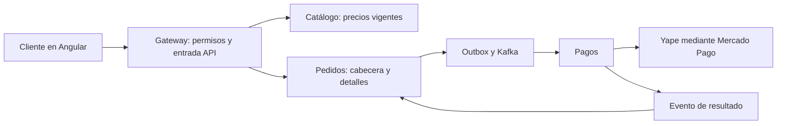

# Guía para encontrar el código

## Frontend: empezar por la pantalla

Todo está en `frontend/portal-web/src/`. Las carpetas de `app/` siguen las áreas visibles del portal.

| Si preguntan por… | Abrir |
| --- | --- |
| Entrada de Angular | `main.ts` |
| Navegación y elección del rol | `app/portal.component.ts` y `app/portal.component.html` |
| Pantalla de bienvenida | `app/bienvenida/` |
| Inicio, historial y expedientes del cliente | `app/cliente/`; `mis-expedientes.component.*` contiene consulta y documentos propios. |
| Catálogo, filtros y pedido con varios servicios | `app/servicios/` |
| Expedientes, documentos y agenda del abogado | `app/abogado/` |
| Panel y edición de servicios del administrador | `app/administracion/panel-admin.component.*` |
| Crear o editar y asignar un expediente | `app/administracion/formulario-expediente.component.*` |
| Registro de clientes y abogados con acceso | `app/administracion/gestion-personas.component.*` |
| Inicio de sesión y API de compras | `app/nucleo/api-portal.ts` |
| API de expedientes y documentos | `app/nucleo/api-expedientes.ts` |
| API del administrador | `app/nucleo/api-administracion.ts` |
| Tokenización del código de Yape | `app/pagos/yape-sdk.ts` |
| Portada, iconos y diseño compartido | `app/compartido/` |
| Tipografía y estilos base | `styles.css` |
| Fotografías y prompts | `assets/images/` |

En Angular, **`.ts` contiene la lógica**, **`.html` la estructura** y **`.css` la presentación**. Los CSS se importan en `styles.css` para funcionar con la política de seguridad de Nginx.

## Backend: seguir la operación

Dentro de cada módulo Java:

- `src/main/java/`: código del servidor.
- `src/main/resources/`: configuración y recursos.
- `pom.xml`: dependencias y compilación Maven.
- `target/`: resultado generado de la compilación; no se edita.

| Operación | Módulo | Archivo o clase para empezar |
| --- | --- | --- |
| Publicar o editar un servicio | `backend/microservicios/catalogo-servicios/` | `ServicioLegalController.java` |
| Crear el pedido con sus detalles | `backend/microservicios/pedidos/` | `OrdenLegalController.java` |
| Entregar la guía al titular de un pedido pagado | Mismo módulo de pedidos | `RecursosPedidoController.java`; PDF en `src/main/resources/guias/` |
| Guardar y publicar eventos del pedido | Mismo módulo de pedidos | `OrdenOutboxEntity.java`, `OrdenOutboxPublisher.java` |
| Preparar o confirmar el pago | `backend/microservicios/pagos/` | `PagoService.java`, `CargoYapeService.java` |
| Comunicación con Mercado Pago para Yape | Mismo módulo de pagos | `MercadoPagoYapeClient.java` |
| Recibir el evento de un pedido | Mismo módulo de pagos | `OrdenEventConsumer.java` |
| Consultar o actualizar un caso | `backend/expedientes/` | `controller/CasoController.java`, `service/CasoService.java` |
| Adjuntar y descargar documentos | Mismo módulo de expedientes | `controller/DocumentoController.java`, `service/DocumentoService.java` |
| Relacionar el usuario de Keycloak con el registro jurídico | Mismo módulo de expedientes | `security/IdentidadJuridicaService.java` |
| Registrar personas y sincronizar sus accesos | Mismo módulo de expedientes | `controller/RegistroController.java`, `service/RegistroService.java`, `service/AccesoRegistroClient.java` |
| Autorizar las rutas de las API | `infraestructura/puerta-enlace/` | `GatewaySecurity.java` |
| Correlacionar solicitudes y ocultar datos de los registros | `backend/compartido/` | `observabilidad/Correlation.java`, `SafeObservationLayout.java` |
| Formato y huella de eventos de pedidos y pagos | `backend/compartido/` | `mensajeria/EventEnvelope.java` |

Las clases de expedientes están dentro de `src/main/java/com/casoslegales/`. Las clases de microservicios están dentro de `src/main/java/com/illarilegal/`, en el paquete de su módulo.

Las utilidades compartidas tienen una sola implementación y se empaquetan dentro de los servicios. El POM de la raíz reúne la compilación. Consulta [Organización del código](ORGANIZACION-DEL-CODIGO.md) para distinguir módulos activos, pruebas y salidas generadas.

## Recorrido de una compra

El precio se consulta y calcula en el servidor. El frontend muestra la selección; el servidor crea el pedido y coordina el pago. El token de pago se obtiene con el SDK; las credenciales privadas del proveedor están en el servidor.

## Términos para explicar

| Término | Qué significa en este proyecto |
| --- | --- |
| Componente | Una parte de la interfaz Angular con lógica y plantilla. |
| API / endpoint | Una dirección del servidor que recibe una petición, por ejemplo `POST /api/v1/ordenes`. |
| Controller | Recibe y valida una petición HTTP. |
| Service | Ejecuta reglas de negocio. |
| Repository / Entity | Acceso a datos y representación persistente de un registro. |
| Transacción | Operaciones de base de datos que se confirman o revierten juntas. Buscar `@Transactional`. |
| Outbox | Evento guardado junto al cambio de negocio y publicado después. |
| Saga | Coordinación mediante eventos entre pedidos y pagos, con estados y recuperación. |
| Keycloak / JWT | Inicio de sesión, identidad, roles y token firmado. |
| Gateway | Entrada común que comprueba permisos y dirige cada petición. |

## Cómo repartir la exposición entre dos personas

Los archivos SQL también tienen nombres por función: `01-esquema-expedientes.sql`, `02-pedidos-y-eventos.sql`, `03-detalle-de-pedidos.sql`, `04-recuperacion-mensajeria.sql`, `05-vinculos-de-identidad.sql` y `06-registros-y-presentacion.sql`. La creación inicial está en `base-de-datos/inicializacion/`.

El [Brief técnico de Pagatu](https://262dist.github.io/pagatu/proyecto-sello/brief/#3-microservicios-previstos-y-alcance-esperado) pide dos microservicios por integrante, con al menos uno transaccional. El reparto propuesto usa los siguientes componentes.

| Integrante | Microservicio transaccional | Microservicio no transaccional |
| --- | --- | --- |
| 1 | **Pedidos**. Guarda cabecera y detalles, valida el catálogo, calcula el total y recibe la confirmación del pago. | **Catálogo**. Gestiona servicios, precios, disponibilidad y recursos digitales. |
| 2 | **Pagos**. Acredita el resultado de Yape, concilia intentos inciertos y publica el resultado por Kafka. | **Clientes**. Gestiona perfiles de compras y controla el acceso a sus datos. |

Las cuatro carpetas están en `backend/microservicios/`. **Expedientes** complementa la demo con asignación, seguimiento y documentos. Para ese recorrido, revisar `backend/expedientes/`, en especial `SolicitudesService` y `CasoService`.

La clasificación del brief se refiere a la responsabilidad del microservicio de negocio. Cada integrante debe confirmar el reparto según su aporte y respaldarlo con código y evidencias. La [matriz de la Unidad III](../u3-producto.md#microservicios-y-matriz-de-trazabilidad) relaciona esos módulos con indicadores y pruebas.

## Guion detallado de la exposición

La demostración sigue el recorrido que hace un cliente. Primero consulta servicios y registra un pedido. Después confirma el pago de Yape y puede ver el pedido como pagado. Cada integrante toma la parte que le corresponde y explica una regla de negocio con un resultado visible. La defensa también incluye el aporte que cada uno puede respaldar con un cambio propio. [Secuencia sugerida del curso](https://262dist.github.io/pagatu/proyecto-sello/u3-producto/#4-secuencia-sugerida-de-presentacion)

### Preparación y orden

| Momento | Quién habla | Qué deja visible |
| --- | --- | --- |
| Apertura, 1 minuto | Integrante 1 | El portal y el problema que resuelve. |
| Catálogo y Pedidos, 4 minutos | Integrante 1 | Dos servicios elegidos y el número del pedido pendiente. |
| Pagos y Clientes, 4 minutos | Integrante 2 | El pago acreditado del pedido #15 y la consulta protegida de perfiles. |
| Integración y cierre, 3 minutos | Ambos | Grafana, las responsabilidades de cada servicio y un aporte por persona. |

Los tiempos son orientativos. Si presentan desde la laptop que ejecuta Docker, abran el [portal local](http://localhost:4200/). Si el docente entra desde otro equipo, compartan la URL HTTPS vigente. Mantengan el túnel encendido porque el inicio de sesión del despliegue público también se usa al entrar por `localhost`. Dejen a mano [Grafana](http://127.0.0.1:3000/d/illari-s12-overview/illari-legal-observabilidad?from=now-15m&to=now), [Prometheus](http://127.0.0.1:9090/targets) y la [consola de Keycloak](http://localhost:18180/admin/master/console/#/illari-legal/users) en la laptop.

La cuenta `mateo.cliente` sirve para recorrer la compra. El equipo puede usar el mismo tipo de cuenta durante la demo. Los roles del portal determinan permisos. El reparto de la exposición determina quién explica cada microservicio.

**Apertura sugerida.** «Illari Legal permite contratar servicios legales y seguir su pago desde una cuenta. Dividimos esa operación entre microservicios. Mi compañero y yo vamos a mostrar qué datos maneja cada uno y cómo se comunica con los demás».

### Integrante 1 · Catálogo y Pedidos

#### Catálogo, módulo no transaccional

**Qué hace.** Mantiene la información que el cliente necesita antes de contratar. Cada servicio tiene identificador, nombre, descripción, categoría, precio y estado. Si el servicio es un recurso digital, la ficha también indica si hay un archivo de entrega. Un administrador puede gestionar esas fichas desde **Servicios**.

**Qué abre y qué hace.** Entra como cliente y pulsa **Servicios**. Muestra dos servicios disponibles, señala sus precios exactos y agrega ambos a la selección. Antes de continuar, muestra el resumen que calcula y presenta Angular. Para enseñar la respuesta del servidor, abre en otra pestaña el [listado de servicios a través del Gateway](http://127.0.0.1:18080/api/v1/servicios). Busca en él uno de los servicios que acabas de seleccionar y compara su nombre y precio con la pantalla.

**Cómo lo explica.** «Cuando abro Servicios, Angular solicita el catálogo al Gateway. El Gateway dirige la petición a Catálogo. Catálogo consulta sus datos y devuelve los servicios. Su función en esta parte es mantener la información de cada servicio, como el precio y la disponibilidad. Por eso encaja como módulo CRUD en el reparto del curso».

**Dónde señala el código.** `listar()` en `ServicioLegalController.java` recibe `GET /api/v1/servicios`. `obtener()` usa `GET /api/v1/servicios/{id}` para leer un servicio en particular. Esta segunda consulta también permite a Pedidos validar cada selección. [Abrir controlador del catálogo](../backend/microservicios/catalogo-servicios/src/main/java/com/illarilegal/serviciolegal/ServicioLegalController.java)

#### Pedidos, módulo transaccional

**Qué hace.** Convierte una selección en una orden que queda registrada. La cabecera guarda el número, el cliente, el estado, el método de pago y el total. El detalle guarda una fila por servicio, con su cantidad, precio unitario y subtotal. Guardar el precio en el detalle permite consultar el importe contratado aunque luego cambie el catálogo.

**Qué abre y qué hace.** Con los dos servicios seleccionados, pulsa **Continuar al pago**. Espera a que aparezcan el pedido y el total. Anota el número, comprueba que el importe coincide con la suma y vuelve a **Mis pedidos** si quieres mostrarlo como pendiente. Puedes terminar esta parte en el formulario de Yape con el código vacío. **Continuar al pago** crea el pedido. El cobro se envía al pulsar **Pagar** con los datos del titular.

**Qué pasa por dentro.** Angular manda `POST /api/v1/ordenes` con la selección. Pedidos identifica al usuario mediante su sesión y consulta a Catálogo por cada servicio. Valida que el servicio exista, se encuentre disponible y tenga un precio válido. Multiplica cada precio por su cantidad y suma los subtotales. En una transacción de base de datos guarda la cabecera, sus detalles y un evento pendiente de publicación. Esa orden nace con estado `PENDIENTE_PAGO`.

**Cómo lo explica.** «Al enviar mi selección, Pedidos toma los precios vigentes de Catálogo y calcula el total en el servidor. Aquí se ve un pedido con dos detalles. En la misma transacción guarda los datos del pedido y deja registrado el evento que permitirá a Pagos preparar el cobro».

**Dónde señala el código.** En `OrdenLegalController.java`, abre `crear()` para mostrar el cálculo de `total`, la creación de `OrdenEntity` y el guardado del evento. Luego señala `crearDetalle()` para mostrar la consulta a Catálogo y el cálculo `precio × cantidad`. `OrdenEntity` representa `ordenes_legales` y `OrdenDetalleEntity` representa `orden_detalle`. [Abrir código que crea el pedido](../backend/microservicios/pedidos/src/main/java/com/illarilegal/ordenlegal/OrdenLegalController.java)

**Decisión técnica para defender.** El pedido conserva los precios contratados. Eso hace que el historial sea consistente, y crear una compra depende de que Catálogo pueda responder con los precios vigentes. Si les preguntan por un doble clic o una respuesta perdida, `CompraIdempotenteService` usa una clave por cliente y solicitud. Repetir la misma compra con esa clave recupera el pedido ya creado. Usar la misma clave para otros datos devuelve conflicto. [Abrir control de duplicados](../backend/microservicios/pedidos/src/main/java/com/illarilegal/ordenlegal/CompraIdempotenteService.java)

**Pase al integrante 2.** «Ya tenemos un pedido pendiente. Pedidos publica `orden.creada` para que el servicio de Pagos prepare el registro correspondiente. Ahora mi compañero explica cómo se confirma el cobro».

### Integrante 2 · Pagos y Clientes

#### Pagos, módulo transaccional

**Qué hace.** Administra el cobro vinculado a un pedido. Cuando Pagos recibe `orden.creada` en el topic `illari.orden.creada`, prepara un registro pendiente con el número de pedido, el cliente y el monto. El formulario pide el celular y el código de aprobación que genera Yape. Angular usa el SDK de Mercado Pago para obtener un token de pago. El backend envía el cobro con ese token y sus credenciales de servidor.

**Qué abre y qué hace.** Primero señala en el pedido recién creado dónde se ingresan el celular y el código de aprobación. Luego abre **Mis pedidos → Pedido #15 → Ver pago**. Indica que este segundo pedido corresponde a una compra real anterior de la **Guía de bienvenida digital** por **S/ 1.24**. Señala **Pago acreditado** y la opción **Descargar guía**. Así enseñas qué ve el cliente cuando se completa el cobro sin generar otro. [Evidencia del cobro real](INCIDENCIA-YAPE.md#confirmación-real-por-s-124)

**Qué pasa por dentro.** `POST /api/v1/pagos/{id}/yape` recibe la solicitud de cobro. Pagos comprueba que el registro pertenezca al cliente y verifica los datos devueltos por Mercado Pago, entre ellos el importe, la moneda y el medio. Cuando resulta acreditado, el pago queda `VALIDADO` y se prepara `pago.validado` para publicarlo en `illari.pago.resultado`. Pedidos recibe ese resultado, comprueba que corresponda a la orden y la cambia a `PAGADA`. El portal puede mostrar el pago confirmado y habilitar el PDF para su titular.

**Cómo lo explica.** «El número de pedido identifica la compra. Pagos se encarga de cobrar ese importe y registrar el resultado. Cuando Mercado Pago lo acredita, Pagos avisa a Pedidos por Kafka. Aquí vemos las dos evidencias del pedido 15: el pago acreditado y la guía que ya se puede descargar».

**Dónde señala el código.** En `OrdenEventConsumer.java`, muestra cómo llega el evento de creación. En `CargoYapeService.java`, abre `cobrar()` y `verificarOrden()` para explicar la validación. `MercadoPagoYapeClient.java` llama a la pasarela. `ResultadoPagoOutbox.java` registra `pago.validado` y `PagoOutboxPublisher.java` lo publica. [Abrir lógica de Yape](../backend/microservicios/pagos/src/main/java/com/illarilegal/pago/CargoYapeService.java)

**Decisión técnica para defender.** Si el resultado del proveedor queda incierto, el sistema conserva el intento y consulta a Mercado Pago antes de aceptar otro cobro para esa orden. Eso reduce el riesgo de duplicar un pago, y el cliente puede ver un estado de verificación mientras se confirma el resultado. La recuperación de un intento existente se explica en `conciliar()`. [Diagnóstico y conciliación](INCIDENCIA-YAPE.md)

#### Clientes, módulo no transaccional

**Qué hace.** Guarda el perfil de compras en `clientes_distribuidos`. Un perfil puede reunir nombre, correo, teléfono y estado. Se vincula con la identidad que Keycloak incluye en el token como `sub`. Ese identificador permite buscar al titular a partir de su sesión.

**Qué abre y qué explica.** Abre `ClienteController.java` en `miPerfil()`. Señala cómo `GET /api/v1/clientes/me` usa `jwt.getSubject()` para consultar el perfil vinculado. En el mismo archivo, `POST /api/v1/clientes/me` permite al cliente registrar su perfil y devuelve conflicto si ya existe. El directorio general `GET /api/v1/clientes` exige un rol autorizado.

**Qué se puede demostrar hoy.** La consulta autenticada al directorio devolvió `200` para la administradora y una lista vacía. Con la cuenta de cliente devolvió `403`. La consulta del perfil propio con Mateo devolvió `404` porque todavía no hay un perfil de compras registrado para él. En el ensayo, pueden mostrar esos resultados y explicar por qué son distintos. Para una demostración con un perfil visible, queda preparar uno de ejemplo mediante `POST /api/v1/clientes/me` con una sesión de cliente y luego consultar `/me`. La pantalla **Equipo → Clientes** gestiona el registro del módulo Expedientes en `/api/clientes`. [Abrir el controlador del microservicio Clientes](../backend/microservicios/clientes/src/main/java/com/illarilegal/cliente/ClienteController.java)

**Cómo lo explica.** «Keycloak autentica al usuario y nos da su identificador. Clientes usa ese identificador para buscar su perfil de compras. La consulta propia y el directorio completo piden permisos distintos. Podemos comprobarlo cambiando la cuenta que hace la petición».

### Conexión entre los dos integrantes

| Conexión | Qué prueba pueden enseñar | Qué dice quien la muestra |
| --- | --- | --- |
| Angular → Gateway → Catálogo | Precios en **Servicios** y respuesta del listado. | «La pantalla consume datos del backend a través de una entrada común». |
| Pedidos → Catálogo por HTTP | Dos servicios en el pedido y código de `crearDetalle()`. | «Pedidos consulta al catálogo en el momento de validar y calcular el total». |
| Pedidos → Kafka → Pagos | Pedido pendiente y formulario de un registro preparado para pagar. | «El evento de creación lleva el identificador y el monto para preparar el pago». |
| Pagos → Kafka → Pedidos | Pedido #15, con pago `VALIDADO` y pedido `PAGADA`. | «Pagos confirma el resultado y Pedidos lo refleja en la orden». |
| Keycloak → servicios protegidos | Rol de una cuenta y respuesta `403` cuando intenta ver el directorio de Clientes. | «Keycloak identifica al usuario y cada servicio verifica los permisos requeridos». |

En el cierre, abran Grafana y elijan **Last 15 minutes**. La primera fila muestra Keycloak y los paneles de Kafka muestran actividad de los servicios. Si el docente pide seguir una solicitud concreta, ejecuten la consulta de catálogo que genera un `traceId` y muéstrenla en los logs de Gateway y Catálogo. Los contadores de Kafka muestran actividad agregada. Para identificar el pedido #15 usen su comprobante y su estado en el portal. [Guía de observabilidad y pasos para mostrar la traza](OBSERVABILIDAD.md#cómo-mostrar-la-conexión-en-la-exposición)

### Preguntas que pueden ensayar

| Pregunta del docente | Respuesta breve |
| --- | --- |
| ¿Por qué Pedidos cuenta como transaccional? | Guarda una orden y sus detalles, aplica reglas de disponibilidad y precio, y registra el evento en la misma transacción local. |
| ¿Por qué Catálogo y Clientes quedan en la otra columna? | Son módulos de consulta y gestión de datos de una entidad, como servicios y perfiles. El brief usa esos CRUD como ejemplos de módulos no transaccionales. |
| ¿Qué pasa si un servicio cambia de precio? | La compra nueva usa el precio vigente. El detalle de una orden ya creada conserva el precio que el cliente contrató. |
| ¿Qué pasa si Catálogo no responde? | Pedidos necesita el precio para validar la compra. Aplica las reglas de resiliencia del cliente de Catálogo y, si sigue sin responder, la creación falla de forma controlada. |
| ¿Qué comunicación es síncrona y cuál es asíncrona? | Pedidos espera la respuesta HTTP de Catálogo para calcular el total. Cuando se crea una orden o se acredita un pago, se guarda un evento y el servicio que lo recibe lo procesa por Kafka. |
| ¿En qué momento se descuenta dinero? | Después de que el titular completa los datos de Yape y confirma **Pagar**. En ese momento el backend envía el cobro al proveedor. |
| ¿Qué diferencia hay entre `VALIDADO` y `PAGADA`? | `VALIDADO` pertenece al registro de Pagos. `PAGADA` pertenece a la orden de Pedidos y se aplica al procesar el evento de confirmación. |
| ¿Qué pasa si Kafka tarda en entregar el resultado? | Durante ese intervalo un pago puede estar confirmado mientras el pedido sigue pendiente. El evento se conserva en la outbox y el portal comprueba el estado del pedido antes de habilitar su recurso. |
| ¿Cómo comprueba Clientes quién pide el perfil? | La API toma el `sub` del token firmado por Keycloak y localiza el perfil de esa identidad. |
| ¿Qué servicios muestran como aporte personal? | Cada uno dice qué microservicios le corresponden, identifica un cambio que hizo, explica su decisión y muestra cómo verificar su resultado. |

### Cierre y aporte personal

El integrante 1 puede cerrar con «Mi evidencia es un pedido con dos servicios y su total calculado». El integrante 2 puede cerrar con «Mi evidencia es un pago confirmado que llegó a Pedidos y la consulta de perfiles protegida por roles». Para demostrar autoría, cada uno prepara una frase propia con **el cambio que hizo, la decisión que tomó y la evidencia que puede abrir en el momento**. Usen su contribución real y, cuando esté disponible, señalen el commit correspondiente.

### Si el docente pide un cambio de texto en vivo

Para cambiar la etiqueta bajo el nombre del cliente, abran `portal.component.html` y ubiquen la expresión que elige entre «Administrador», «Abogado» y «Cliente». Cambien únicamente el texto entre comillas, guarden con **Ctrl+S** y ejecuten **Terminal → Ejecutar tarea → Actualizar portal Angular** en VS Code, o usen el comando indicado en el manual. Después recarguen el portal. Pueden explicar «Angular compila la plantilla editada y Docker carga esa compilación en el contenedor que sirve el portal. El identificador `CLIENTE` sigue determinando los permisos en Keycloak». [Plantilla de Angular](../frontend/portal-web/src/app/portal.component.html) · [Actualizar Angular en Docker](OPERACION.md#comandos)

## Recorrido para presentar los tres roles

Usen el expediente ficticio **#6 · Demostración · Revisión de contrato de arrendamiento**. Está asignado a Lucía Salazar para el cliente Mateo Flores y tiene una ficha de revisión preparada para descargar.

1. Con **Valeria Rojas**, abran **Expedientes**, busquen «Demostración» y pulsen **Consultar**. Muestren el cliente, la abogada asignada y el alcance del caso.
2. Con **Lucía Salazar**, abran **Mis casos** y entren al expediente **#6**. Muestren el estado **En revisión**, el formulario de seguimiento y el documento **Ficha de revisión del contrato (demostración)**.
3. Con **Mateo Flores**, abran **Mis expedientes** y entren al mismo expediente. Comprueben el estado **En revisión** y descarguen la ficha.
4. Para demostrar el pago, mantengan la sesión de Mateo y abran **Mis pedidos → #15**. Muestren la compra de la **Guía de bienvenida digital** por **S/ 1.24**, su confirmación y la descarga del PDF desde ese mismo pedido.

El expediente #6 se preparó desde **Expedientes** para el recorrido de los tres roles. Para mostrar el flujo de atención de una compra, abran **Solicitudes** con Valeria y expliquen que al asignar una asesoría pagada se crea un expediente vinculado al pedido correspondiente.

## Nombres técnicos que se mantienen

Docker usa identificadores internos como `checkout-web`, `backend-legacy` o `orden-legal-ms` para la comunicación existente. Los nombres visibles de sus contenedores son `illari-portal-web`, `illari-expedientes-legales` e `illari-pedidos`. Las carpetas usan esos conceptos legibles. Los nombres de tablas, paquetes Java y eventos se conservan para mantener la compatibilidad con los datos existentes.

## Atención posterior a una compra

- Las asesorías pagadas aparecen en **Administrador → Solicitudes**. El administrador selecciona el abogado y crea el expediente. El cliente se toma del comprador vinculado a Keycloak; no se elige otro cliente para esa compra. Repetir la asignación no duplica el expediente.
- Cliente y abogado consultan el expediente en sus respectivas cuentas. Una reasignación posterior se realiza desde **Expedientes**.
- Los recursos digitales se entregan en PDF. Desde **Servicios**, el administrador elige “Descarga de un PDF”, adjunta el archivo y publica el servicio. Sin PDF, el recurso permanece inactivo. Las compras conservan la versión que contrataron aunque se cambie el archivo del catálogo.
- La guía del pedido 15 sigue disponible. Los libros, cursos y modelos que todavía no tienen archivo se mantienen inactivos; corresponde al administrador adjuntar contenido real y autorizado antes de ofrecerlos.

Su compañero entrará por la misma URL HTTPS de esta computadora. No necesita instalar el proyecto ni importar una copia de las bases. Cada persona debe usar la cuenta de su rol y esta computadora debe mantener los contenedores y el túnel encendidos.
