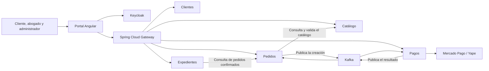

# Illari Legal · Producto final de Unidad III

| Dato | Valor |
| --- | --- |
| Curso | Desarrollo de Aplicaciones Distribuidas |
| Semestre | 2026-2 |
| Sección y grupo | Por completar con los datos oficiales |
| Integrantes | Frank Alexander Pari Abado y Emerlin Obed Fernandez Condori |
| Docente | Por completar |
| Repositorio | [Illari Legal](https://github.com/puma13H/illari-legal) |
| Documentación publicada de U3 | [Documentación de la Unidad III](documentacion/) |

## Problema y alcance

Illari Legal reúne la contratación de servicios legales, sus pagos y el seguimiento de la atención en un portal. El cliente consulta el catálogo, reúne servicios en un pedido y paga con Yape. El servidor confirma el resultado con Mercado Pago y habilita el PDF adquirido. Para una asesoría pagada, el administrador puede asignar un abogado y vincular un expediente al pedido. El abogado registra el seguimiento y adjunta documentos que el cliente autorizado puede consultar.

El objetivo es que el cliente pueda comprobar el estado del pago y de su atención desde su cuenta. El equipo ha verificado un pago real y un recorrido de expedientes con tres roles. La ficha de demostración del expediente #6 y la compra del pedido #15 son registros distintos.

## Microservicios y matriz de trazabilidad

La variable evaluada es **Illari Legal como sistema distribuido**. Frank Alexander Pari Abado presenta Pedidos y tiene Catálogo como segundo módulo. Emerlin Obed Fernandez Condori presenta Pagos y tiene Clientes como segundo módulo.

| Integrante | Dimensión y tipo | Indicador verificable | Componente y técnica | Evidencia |
| --- | --- | --- | --- | --- |
| Frank | Pedidos · transaccional | Conserva cabecera, detalles y total calculado; un reintento de la misma compra devuelve el mismo pedido. | `OrdenLegalController`, `OrdenDetalleEntity` y clave de idempotencia. Consulta resiliente al catálogo y eventos de estado. | Pedido #15 acreditado y pruebas de titularidad y entrega. [Verificación](documentacion/VERIFICACION-DEL-PORTAL.md) |
| Frank | Catálogo · no transaccional | El catálogo muestra servicios y precios. Publicar un recurso digital requiere un archivo. | `ServicioLegalController` y `ArchivosCatalogoService`; persistencia de metadatos y versiones PDF. | Validación de publicaciones y carga de dos versiones por HTTPS. [Verificación](documentacion/VERIFICACION-DEL-PORTAL.md) |
| Emerlin | Pagos · transaccional | Registra el cobro de la orden y valida monto, moneda y método antes de acreditar; recupera intentos inciertos sin enviar otro cargo. | `CargoYapeService`, conciliación con Mercado Pago y publicación de `pago.validado` mediante Kafka. | Pago #15 de S/ 1.24 acreditado y pruebas de rechazo y conciliación. [Diagnóstico Yape](documentacion/INCIDENCIA-YAPE.md) |
| Emerlin | Clientes · no transaccional | Permite consultar el perfil de compras según identidad y restringe el directorio por rol. | `ClienteController`, `DistributedSecurityConfig` y base propia de perfiles. | Contrato `GET /api/v1/clientes/me` y reglas de acceso. Falta guardar la evidencia por integrante de este servicio. |

Keycloak centraliza la identidad. Expedientes es el servicio jurídico complementario. Sus roles y funciones apoyan la demostración de negocio y los controles de autorización.

## Arquitectura y decisiones

Config Server externaliza la configuración y Eureka permite descubrir los servicios registrados. PostgreSQL separa las bases del negocio por servicio. Grafana consulta métricas de Prometheus y logs que Alloy envía a Loki. Blackbox verifica la disponibilidad HTTP de las aplicaciones. El [mapa del proyecto](documentacion/GUIA-DEL-PROYECTO.md) y el [manual de operación](documentacion/OPERACION.md) ubican la configuración y los comandos.

| Decisión | Beneficio | Costo o límite |
| --- | --- | --- |
| Validar catálogo al crear un pedido y guardar sus datos históricos | El precio lo calcula el servidor y se conserva el importe contratado. | Si el catálogo queda inaccesible, iniciar una compra requiere esperar su recuperación. |
| Coordinar el pedido y el pago con Kafka y una bandeja de eventos persistida junto al cambio de estado | El resultado puede entregarse de forma recuperable y procesarse sin duplicar su efecto. | Hay un intervalo entre la confirmación del pago y la actualización del pedido. |
| Vincular la identidad y verificar cada pedido o caso en el servicio dueño del dato | Se pueden aplicar permisos por rol y por titular. | Hay que mantener la vinculación de las cuentas y probar los permisos en cada flujo. |

## Validación y bitácora

| Caso | Resultado comprobado | Evidencia |
| --- | --- | --- |
| Compra acreditada | Pedido #15 en `PAGADA`, pago en `VALIDADO`, importe S/ 1.24 y PDF descargable por su titular. | [Confirmación documentada](documentacion/INCIDENCIA-YAPE.md#confirmación-real-por-s-124) |
| Intento rechazado | El intento anterior de S/ 1.00 conservó su rechazo y el pedido quedó pendiente. El portal valida el importe mínimo configurado antes de enviar el cargo. | [Incidencia de Yape](documentacion/INCIDENCIA-YAPE.md) |
| Roles y pertenencia del dato | El expediente ficticio #6 se asignó, se actualizó y su titular descargó el documento. Otra cuenta fue rechazada al consultar un caso ajeno en las pruebas previas. | [Recorrido de exposición](documentacion/GUIA-DEL-PROYECTO.md#recorrido-para-presentar-los-tres-roles) y [pruebas de permisos](documentacion/VERIFICACION-DEL-PORTAL.md) |
| Observabilidad | Grafana consultó siete sondas exitosas, incluidas la del Gateway y la de Keycloak. El tablero muestra la memoria y las conexiones a PostgreSQL de Keycloak. Una consulta de catálogo por Gateway devolvió 200 y Grafana recuperó la misma traza en `legal-gateway` y `servicio-legal-ms` desde Loki. | [Enlaces y pasos para reproducir la evidencia](documentacion/OBSERVABILIDAD.md). |
| Mensajería | Kafka expone los topics de pedido creado y resultado de pago. Prometheus devolvió métricas de eventos procesados de Pedidos y Pagos. | Panel **Kafka: eventos procesados** en el [tablero de observabilidad](documentacion/OBSERVABILIDAD.md). |
| Instalación desde el código fuente | Una copia aislada arrancó con volúmenes nuevos. Se verificaron el catálogo, el acceso del administrador inicial, las altas de usuarios y el rechazo 403 de un expediente ajeno. | [Prueba y bitácora de instalación](documentacion/VERIFICACION-DEL-PORTAL.md#instalación-desde-una-copia-limpia) |

| Hallazgo | Ajuste | Resultado de la verificación |
| --- | --- | --- |
| El PDF podía tardar en aparecer tras confirmar el pago. | El portal espera el estado pagado del pedido antes de consultar sus recursos. | Una respuesta retrasada simulada en el navegador terminó mostrando la guía sin recargar. |
| Una respuesta de cobro incierta dejaba pendiente el intento. | El servidor consulta la orden existente, valida sus datos y confirma mediante el flujo habitual. | Las pruebas de conciliación comprobaron la confirmación única y la ausencia de nuevos cargos. |

La bitácora se basa en los resultados registrados en [Verificación del portal](documentacion/VERIFICACION-DEL-PORTAL.md). Queda completar el inventario S13 de pruebas por titular y de rutas internas, y documentar la repetición de las pruebas sobre la versión entregada.

## Reproducción y defensa

1. Seguir el [manual de operación](documentacion/OPERACION.md) desde una copia limpia de la versión candidata. Registrar requisitos, configuración, inicio y resultado de cada componente. Probarlo con un entorno de demostración independiente.
2. Abrir el portal y presentar el problema y la arquitectura. Mostrar la compra acreditada #15 y ejecutar el recorrido de atención #6. Para la validación en vivo, mostrar también un rechazo de acceso y la correlación en Grafana.
3. Cada integrante presenta sus microservicios, muestra una evidencia propia y explica qué gana y qué cuesta una decisión técnica.

## Pendientes antes de entregar

- Completar los datos oficiales del docente, la sección y el grupo, y reunir las evidencias individuales.
- Completar los topics académicos del repositorio.
- Repetir el arranque desde un clon de la versión publicada en GitHub. Conservar la evidencia del error controlado y la recuperación para la demo.
- Reunir evidencia de un fallo controlado y del balanceo con una segunda instancia de catálogo.

La estructura sigue el [Producto U3 de Pagatu](https://262dist.github.io/pagatu/proyecto-sello/u3-producto/), y la validación se organiza según [S13](https://262dist.github.io/pagatu/sesiones/S13_Validacion_End_to_End_Producto/) y [S14](https://262dist.github.io/pagatu/sesiones/S14_Revision_Tecnica_Estabilizacion/).
